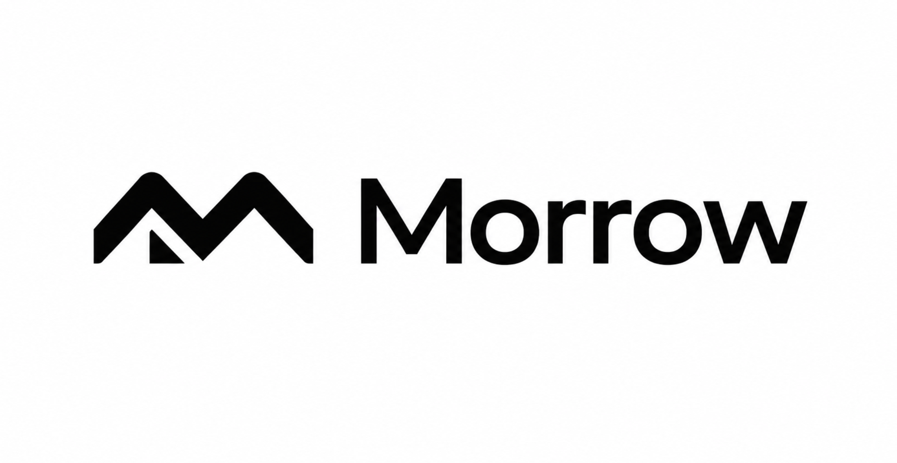

<div align="center">



**一个真正理解学习者的开源 AI 学习伙伴。**

[](LICENSE)
[](https://tauri.app)
[](https://react.dev)
[](https://www.typescriptlang.org)
[](https://www.rust-lang.org)
[](https://tailwindcss.com)
[](#项目状态)

[English](README.md) · **中文**

</div>

---

## 这是什么

Morrow Agent 是一个桌面与移动端的 **AI 学习工作区**，它围绕一个主张构建：好的 AI 老师应该让自己变得不必要。内置智能体 Lumi 不会答完就离开，而是先诊断学习者真正没弄懂的地方，针对那个缺口教学，再用新题验证是否真的补上了。

它不是套了数学提示词的聊天窗口。对话、题目卡片、画板、知识树、错题本与模拟考试属于同一个学习闭环，每一次操作都会作为证据写回持续演化的学习者模型。

首个版本面向 **陕西专升本高等数学**。

## 学习闭环

```text
理解学习者
    ↓
发现知识盲区
    ↓
追溯根本原因
    ↓
个性化教学
    ↓
针对性训练
    ↓
验证真实掌握
    ↓
培养独立学习能力
```

## 功能

| 模块 | 能力 |
| --- | --- |
| **Lumi 工作台** | 对话中渲染真实组件——题目卡片、公式输入、数学画板、函数图像、知识图谱——并把用户操作结构化回传。 |
| **自适应诊断** | 覆盖式诊断卷、假设驱动的追问、变式验证；疑似弱项必须被证实才写入画像。 |
| **学习画像** | 掌握度（0–100）与置信度严格分离，并记录错误类型、能力维度与跨会话的长期记忆。 |
| **错题本** | 自动收录原题、作答、解析与归因的错误类型。 |
| **模拟考试** | 真实 22 题位试卷结构、固定计时、常驻答题卡，交卷后给出成绩总结与逐题分析。 |
| **知识库** | 章节树、知识图谱，笔记中的题目引用可直接点击预览。 |
| **学习包** | 带版本号的 `.morrow` 归档（MLPS），包含知识点、题目、解析、词表与来源，可安装、可校验、可更新。 |
| **本地优先** | SQLite 存在应用数据目录；每个学习包是独立工作区，个人数据与公共内容永不混用。 |
| **供应商** | 兼容 OpenAI、Anthropic、Gemini 三种协议，并内置可应用内登录的 DeepSeek 供应商。 |

## 技术栈

| 层 | 选型 |
| --- | --- |
| 外壳 | Tauri 2（Windows、Android） |
| 界面 | React 19 · TypeScript · Tailwind CSS v4 · BeUI · Gravity Icons |
| 动效 | `motion`（Framer Motion） |
| 数学 | KaTeX |
| 后端 | Rust · `rusqlite` · `reqwest` |
| 存储 | SQLite + `%APPDATA%\dev.morrow.agent\` 下的 JSON 偏好文件 |
| 内容 | 由 JSON Schema 校验的 YAML / JSON 学习包 |

## 快速开始

```bash
# 依赖：Node.js 20+、pnpm 9+、Rust 1.77+、Tauri 环境

pnpm install
pnpm tauri:dev          # 启动桌面应用
```

仅前端的开发与检查：

```bash
pnpm dev                # Vite 开发服务器 http://127.0.0.1:1420
pnpm typecheck          # tsc -b
pnpm test               # vitest
pnpm build              # 类型检查 + 生产构建
```

## 目录结构

```text
MorrowAgent/
├── src/                  React 前端
│   ├── app/              外壳、路由、Provider
│   ├── components/       共享基础组件（Modal、MathText、EmptyState…）
│   ├── features/         领域模块（lumi、knowledge、training、exam…）
│   ├── pages/            路由页面
│   └── vendor/beui/      内置的 BeUI 组件库
├── src-tauri/            Rust 后端、命令、包引擎、SQLite
├── packages/             学习包源文件（不入库）
├── scripts/              校验、打包、知识库构建
├── schemas/              知识点与 MLPS 内容的 JSON Schema
├── .github/workflows/    持续集成与安装包发布流程
└── docs/                 产品、设计、AI、数据与工程文档
```

## 发布

CI 在每次推送到 `main` 和每个 Pull Request 上运行：类型检查、单元测试、生产构建，然后在 Windows 上跑 `clippy -D warnings` 与 `cargo test`。

发布由版本标签触发：推一个标签，`Release` 工作流就会构建 Windows 安装包并直接发布，中间不需要人工操作。

```bash
# 改完五处版本号并提交后：
git tag v0.2.0
git push origin main --tags     # 产出 .msi 与 NSIS 安装包，并发布 Release
```

版本号写在五个文件里（`package.json`、`src-tauri/Cargo.toml`、`src-tauri/tauri.conf.json`、`src/app/config.ts`、`src-tauri/src/package/mod.rs`）；`pnpm check:version` 会断言它们一致。标签与版本号不符、或标签所在的提交不在 `main` 的历史里，都会在编译前失败。

手动触发同一个工作流只产出安装包并上传为 workflow 产物，不会创建或修改 Release。

## 文档

- **[DOCS.md](DOCS.md)** —— 文档总索引，含重要文档表格。
- **[docs/理念体系.md](docs/理念体系.md)** —— 产品理念：教育公平、自主学习、AI Native 与品牌哲学。
- **[docs/04-Data/Package-Authoring-Guide.zh-CN.md](docs/04-Data/Package-Authoring-Guide.zh-CN.md)** —— 如何产出一个能装、能读、能出卷、能画像的学习包。

## 项目状态

MVP 开发中。参考学习包（`cn.morrow.calculus.shaanxi-upgrade`）包含 13 章、72 个知识点、153 道题与一一对应的解析，并通过完整包校验。

## 许可证

GNU General Public License v3.0 —— 见 [LICENSE](LICENSE)。
